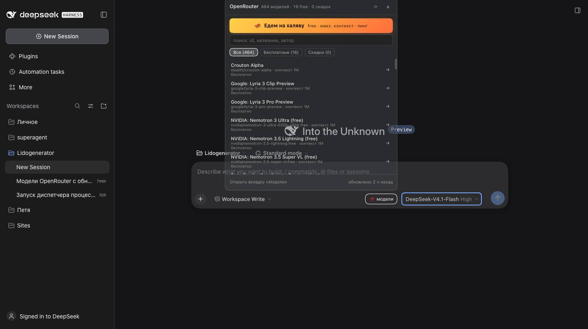

# OpenRouter Explorer Free (dsh-openrouter-explorer-free)

Плагин для [DeepSeek Harness](https://github.com/deepseek-ai/deepseek-harness): **вкладка «Модели OpenRouter»** в правой
боковой панели — живой каталог моделей с ценой каждой, бесплатные модели, скидки, автообновление раз в 24 часа
и суперкнопка **«Едем на халяву»**: находит бесплатную модель с максимальным контекстом, пингует её, включает
в провайдера OpenRouter и переключает на неё текущую сессию.



## Что внутри

| Возможность | Как работает |
|---|---|
| **Каталог с ценами** | `GET https://openrouter.ai/api/v1/models` (публичный, без ключа). Цены входа/выхода переводятся в **$ за 1M токенов**, сохраняются контекст, модальность, дата релиза, `:batch`/`:free`-варианты и `pricing.overrides` |
| **Автообновление 24 ч** | Планировщик в host-части: `next_sync_at` хранится в состоянии, тик раз в 5 минут, после перезапуска расписание не сбивается; при ошибке сети — повтор через час |
| **Бесплатные модели** | Модель считается бесплатной, только если **все** денежные компоненты цены равны нулю (токены, картинки, аудио, web_search); фильтр и KPI в интерфейсе |
| **Скидки** | OpenRouter не отдаёт поле «скидка», поэтому цена сравнивается с **собственной** историей: предыдущий замер и максимум за 30 дней, порог 30%. Пишутся события «цена упала», «подорожала», «стала бесплатной», «исчезла», «скоро исчезнет» |
| **«Едем на халяву»** | Бесплатные chat-модели сортируются по размеру контекста; до 6 кандидатов пингуются реальным `chat/completions` (батчами по 3); первая ответившая модель добавляется в `models` провайдера OpenRouter через `ctx.configEditor` и выбирается для текущей сессии |
| **Меню в композере** | Кнопка **«🛷 модели»** рядом с выбором модели раскрывает каталог: KPI, «Едем на халяву», поиск, фильтры и список моделей с ценами; клик по модели добавляет её в провайдера и переключает сессию |
| **Цена в меню моделей** | Слот `conversation.input.model.label` показывает цену $/1M, «бесплатно» и скидку прямо в штатном селекторе модели |
| **Журнал** | Последние события каталога в том же окне, с отметкой «прочитано» |

История цен, журнал и настройки лежат в `$DSH_HOME/openrouter-explorer-free/state.json` (по умолчанию `~/.dsh/openrouter-explorer-free/state.json`).
Первый замер — базовая линия: события «новая модель» на нём не создаются, скидки появляются после второго замера.

## Установка

Плагин — обычный DSH-бандл (`dsh.bundle` + `dsh.client`), поэтому ставится в профиль через штатный менеджер:

```sh
# из папки, где лежит этот репозиторий
dsh plugin --profile web add ./dsh-openrouter-explorer-free
```

Для Web-профиля из исходников харнеса (`pnpm dev:web`) — то же самое, но командой `pnpm dsh ...`.
После установки HMR пересобирает профиль на лету, отдельный перезапуск обычно не нужен.

Открыть: **кнопка «🛷 модели» в композере** (сразу рядом с выбором модели) — раскрывает меню каталога;
полный дашборд — **правая боковая панель → «+» → «Модели OpenRouter»**.

Удалить:

```sh
dsh plugin --profile web remove dsh-openrouter-explorer-free
```

## Настройка

Строка `openrouter-explorer-free` в `~/.dsh/profiles/web/cordis.patch.yml`:

```yaml
- id: openrouter-explorer-free
  name: dsh-openrouter-explorer-free
  config:
    provider: openrouter            # id провайдера в llm-pi-ai
    providerEntryId: llm-pi-ai      # строка Loader, у которой правится каталог моделей
    intervalHours: 24               # период автообновления
    discountPct: 30                 # порог «большой скидки», %
    journalDays: 90                 # срок жизни журнала и замеров синка, дней
    apiKeyRef: OPENROUTER_API_KEY   # ссылка на credential, НЕ сам ключ
    maxCandidates: 6                # сколько бесплатных моделей пинговать
    source: https://openrouter.ai/api/v1/models
```

### Ключ и подключение провайдера

Ключ OpenRouter берётся из DSH-credentials (`ctx.credentials.resolve('OPENROUTER_API_KEY')`) или из переменной
окружения с тем же именем. **В репозитории и конфигах плагина ключа нет и быть не должно** — только ссылка.

При первом запуске плагин сам проверяет маршрут `openrouter` в профиле:
- маршрут уже есть — ничего не трогает (ни `models`, ни `displayName`, ни другие провайдеры);
- маршрута нет — добавляет его с `apiKeyEnv: OPENROUTER_API_KEY`, `api: openai-completions` и
  `baseURL: https://openrouter.ai/api/v1` (список моделей пуст, пополняется по мере выбора).
- **Текущая модель не меняется**: ни при установке, ни при обновлении каталога; сессия и модель по
  умолчанию не затрагиваются. Выбор модели происходит только по явному действию в меню/кнопке.

Отключить автоподключение: `autoProvision: false` в конфиге строки.

## HTTP API

Вкладка общается с host-частью по своему префиксу (не через RPC):

| Метод | Путь | Что отдаёт |
|---|---|---|
| GET | `/openrouter-explorer-free/status` | статус синка, тоталы, `next_sync_at` |
| GET | `/openrouter-explorer-free/models` | `{ status, models }`, фильтры `q`, `free`, `discount`, `modality`, `sort`, `limit` |
| GET | `/openrouter-explorer-free/events` | журнал событий, `limit`, `unread`, `type` |
| GET | `/openrouter-explorer-free/settings` | действующие настройки |
| POST | `/openrouter-explorer-free/events/read` | `{ all: true }` или `{ ids: [...] }` |
| POST | `/openrouter-explorer-free/sync` | ручное обновление каталога |
| POST | `/openrouter-explorer-free/auto-route` | `{ sessionId }` → пинг + включение модели + переключение сессии |
| POST | `/openrouter-explorer-free/use-model` | `{ sessionId, model }` → включение модели в провайдер + переключение сессии |

## Структура

```
index.js                entry: host-плагин (mount сервиса и API)
cordis.patch.yml        слой бандла (одна строка openrouter-explorer-free)
lib/client.js           browser half: вкладка правой панели (client-module формат)
src/host/catalog.js     чистая логика: нормализация, история, скидки, события
src/host/service.js     сеть, состояние, планировщик, auto-route
src/host/provider.js    включение модели в провайдера через config-editor
src/host/api.js         HTTP-маршруты вкладки
src/host/state.js       атомарная запись состояния
tests/                  node:test, без сети
```

## Разработка

```sh
npm test        # node --test tests/
npm run check   # синтаксис + тесты
```

Плагин не требует сборки: `lib/client.js` — самодостаточный browser-бандл в формате загрузчика клиентских
модулей DSH (React и Cordis приходят из базовых модулей оболочки). После правки `lib/client.js` достаточно
перезагрузить страницу (короткий путь — пересобрать профиль правкой `cordis.patch.yml`).

## Журнал и состояние: срок жизни и защита

| Что | Лимит / срок |
|---|---|
| Журнал событий | **90 дней** (`journalDays`) и не более 500 записей |
| Замеры синка (`syncs`) | 30 последних в пределах 90 дней |
| История цен на модель | 60 точек |
| Удалённые модели | остаются в данных 90 дней, затем вычищаются |
| Файл состояния | ~300 КБ на 464 моделях; рост ограничен лимитами выше |

Срок можно менять: `journalDays` в конфиге строки. В `GET /openrouter-explorer-free/status` есть блок
`journal` (`events`, `unread`, `oldest_at`, `retention_days`), чтобы видеть фактический возраст журнала.

**Одновременные процессы.** Несколько профилей могут работать на одном `DSH_HOME` (Web GUI + headless CLI).
Плагин не держит снапшот в памяти: чтение идёт с диска, запись — под локом `state.json.lock` с очисткой
протухшего лока, поэтому процессы не затирают историю и журнал друг друга.

Проверка: `node --test tests/` (включая retention, дубли, гонки двух инстансов) и
`node scripts/test-profiles.mjs` (матрица профилей).

## Универсальность: профили, ОС, версии

Плагин — обычный DSH-бандл и не привязан к Web-профилю:

| Профиль | Что работает |
|---|---|
| `web`, `desktop` | всё: каталог, вкладка, меню в композере, цены в селекторе, автороут |
| `headless`, `sdk`, `acp` | каталог и планировщик 24 ч (история цен общая), HTTP-API и UI отсутствуют |

Проверка матрицы профилей (безопасно: временный `DSH_HOME`, ваш профиль не трогается):

```sh
node scripts/test-profiles.mjs          # web, headless, sdk, acp → 4/4 PASS
DSH_BIN=/path/to/dsh node scripts/test-profiles.mjs
```

Что проверяется на каждый профиль: профиль создаётся из шаблона → бандл ставится через `dsh plugin add` →
строка `openrouter-explorer-free` присутствует в `--dump-config`. Плюс юнит-тест `tests/entry.test.mjs`
доказывает, что host-плагин загружается **без** `webServer`.

Ограничения по среде: Node ≥ 22 (в DSH — ≥ 24.9), macOS/Linux/Windows (CI гоняет юнит-тесты на всех трёх),
`engines.dsh: >=0.2.0 <0.3.0` — совместимость с мажорной линейкой харнесса. Другие агентские харнессы
(не DSH) не поддерживаются: плагин использует Cordis-сервисы DSH.

## Языки

UI мультиязычный: namespace `openrouterExplorer`, словари `ru` и `en`; активный язык берётся из
locale-сервиса харнесса, для остальных локалей используется английский. Переводятся меню, вкладка, KPI,
журнал, кнопки, подсказки и тосты. Добавить язык — дописать словарь в `MESSAGES` в `lib/client.js`
(ключи общие). Сообщения HTTP-API остаются служебными (русский/английский), это внутренний транспорт.

## Ограничения

- Каталог — **публичный**: с ключом аккаунта OpenRouter часть моделей скрыта настройками аккаунта, поэтому
  список в харнессе (видны модели ключа) и вкладка (публичный каталог) могут отличаться по количеству.
- «Скидка» — только относительно истории самой модели; на первом замере история пустая, поэтому бейджи
  «−N%» появляются после следующего обновления. Это честно подписано в интерфейсе.
- Переключение сессии на бесплатную модель меняет модель текущего диалога — это и есть цель кнопки,
  но откатить можно обычным выбором модели в композере.
- Плагин рассчитан на Web-профиль (нужен `webServer`); в headless/SDK-профилях строка не активируется.

## Лицензия

MIT — см. [LICENSE](LICENSE).
