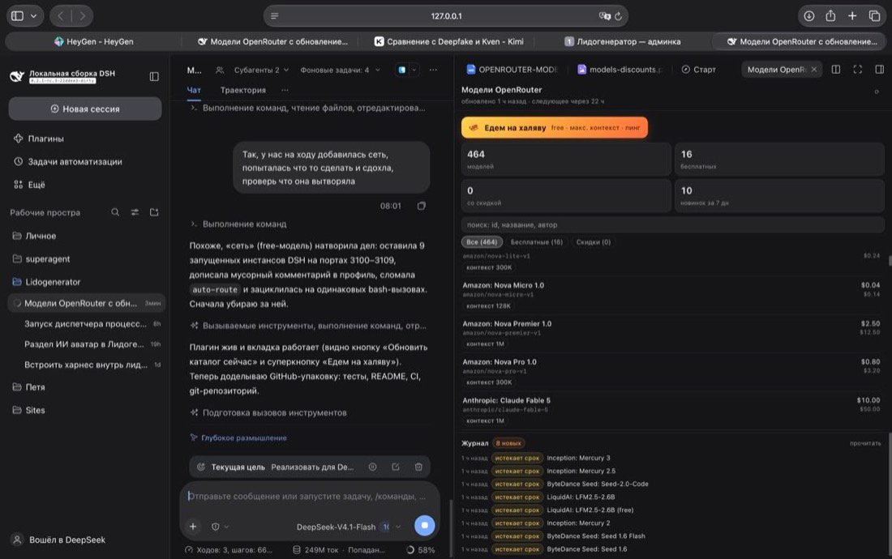

# dsh-openrouter-models

Плагин для [DeepSeek Harness](https://github.com/deepseek-ai/deepseek-harness): **вкладка «Модели OpenRouter»** в правой
боковой панели — живой каталог моделей с ценой каждой, бесплатные модели, скидки, автообновление раз в 24 часа
и суперкнопка **«Едем на халяву»**: находит бесплатную модель с максимальным контекстом, пингует её, включает
в провайдера OpenRouter и переключает на неё текущую сессию.



## Что внутри

| Возможность | Как работает |
|---|---|
| **Каталог с ценами** | `GET https://openrouter.ai/api/v1/models` (публичный, без ключа). Цены входа/выхода переводятся в **$ за 1M токенов**, сохраняются контекст, модальность, дата релиза, `:batch`/`:free`-варианты и `pricing.overrides` |
| **Автообновление 24 ч** | Планировщик в host-части: `next_sync_at` хранится в состоянии, тик раз в 5 минут, после перезапуска расписание не сбивается; при ошибке сети — повтор через час |
| **Бесплатные модели** | Модель считается бесплатной, только если **все** денежные компоненты цены равны нулю (токены, картинки, аудио, web_search); фильтр и KPI в интерфейсе |
| **Скидки** | OpenRouter не отдаёт поле «скидка», поэтому цена сравнивается с **собственной** историей: предыдущий замер и максимум за 30 дней, порог 30%. Пишутся события «цена упала», «подорожала», «стала бесплатной», «исчезла», «скоро исчезнет» |
| **«Едем на халяву»** | Бесплатные chat-модели сортируются по размеру контекста; до 6 кандидатов пингуются реальным `chat/completions` (батчами по 3); первая ответившая модель добавляется в `models` провайдера OpenRouter через `ctx.configEditor` и выбирается для текущей сессии |
| **Журнал** | Последние события каталога в том же окне, с отметкой «прочитано» |

История цен, журнал и настройки лежат в `$DSH_HOME/openrouter-models/state.json` (по умолчанию `~/.dsh/openrouter-models/state.json`).
Первый замер — базовая линия: события «новая модель» на нём не создаются, скидки появляются после второго замера.

## Установка

Плагин — обычный DSH-бандл (`dsh.bundle` + `dsh.client`), поэтому ставится в профиль через штатный менеджер:

```sh
# из папки, где лежит этот репозиторий
dsh plugin --profile web add ./dsh-openrouter-models
```

Для Web-профиля из исходников харнеса (`pnpm dev:web`) — то же самое, но командой `pnpm dsh ...`.
После установки HMR пересобирает профиль на лету, отдельный перезапуск обычно не нужен.

Открыть: **правая боковая панель → «+» → «Модели OpenRouter»** (или значок раскрытия правой панели).

Удалить:

```sh
dsh plugin --profile web remove dsh-openrouter-models
```

## Настройка

Строка `openrouter-models` в `~/.dsh/profiles/web/cordis.patch.yml`:

```yaml
- id: openrouter-models
  name: dsh-openrouter-models
  config:
    provider: openrouter            # id провайдера в llm-pi-ai
    providerEntryId: llm-pi-ai      # строка Loader, у которой правится каталог моделей
    intervalHours: 24               # период автообновления
    discountPct: 30                 # порог «большой скидки», %
    apiKeyRef: OPENROUTER_API_KEY   # ссылка на credential, НЕ сам ключ
    maxCandidates: 6                # сколько бесплатных моделей пинговать
    source: https://openrouter.ai/api/v1/models
```

Ключ OpenRouter берётся из DSH-credentials (`ctx.credentials.resolve('OPENROUTER_API_KEY')`) или из переменной
окружения с тем же именем. **В репозитории и конфигах плагина ключа нет и быть не должно** — только ссылка.

## HTTP API

Вкладка общается с host-частью по своему префиксу (не через RPC):

| Метод | Путь | Что отдаёт |
|---|---|---|
| GET | `/openrouter-models/status` | статус синка, тоталы, `next_sync_at` |
| GET | `/openrouter-models/models` | `{ status, models }`, фильтры `q`, `free`, `discount`, `modality`, `sort`, `limit` |
| GET | `/openrouter-models/events` | журнал событий, `limit`, `unread`, `type` |
| GET | `/openrouter-models/settings` | действующие настройки |
| POST | `/openrouter-models/events/read` | `{ all: true }` или `{ ids: [...] }` |
| POST | `/openrouter-models/sync` | ручное обновление каталога |
| POST | `/openrouter-models/auto-route` | `{ sessionId }` → пинг + включение модели + переключение сессии |

## Структура

```
index.js                entry: host-плагин (mount сервиса и API)
cordis.patch.yml        слой бандла (одна строка openrouter-models)
lib/client.js           browser half: вкладка правой панели (client-module формат)
src/host/catalog.js     чистая логика: нормализация, история, скидки, события
src/host/service.js     сеть, состояние, планировщик, auto-route
src/host/provider.js    включение модели в провайдера через config-editor
src/host/api.js         HTTP-маршруты вкладки
src/host/state.js       атомарная запись состояния
tests/                  node:test, без сети
```

## Разработка

```sh
npm test        # node --test tests/
npm run check   # синтаксис + тесты
```

Плагин не требует сборки: `lib/client.js` — самодостаточный browser-бандл в формате загрузчика клиентских
модулей DSH (React и Cordis приходят из базовых модулей оболочки). После правки `lib/client.js` достаточно
перезагрузить страницу (короткий путь — пересобрать профиль правкой `cordis.patch.yml`).

## Ограничения

- Каталог — **публичный**: с ключом аккаунта OpenRouter часть моделей скрыта настройками аккаунта, поэтому
  список в харнессе (видны модели ключа) и вкладка (публичный каталог) могут отличаться по количеству.
- «Скидка» — только относительно истории самой модели; на первом замере история пустая, поэтому бейджи
  «−N%» появляются после следующего обновления. Это честно подписано в интерфейсе.
- Переключение сессии на бесплатную модель меняет модель текущего диалога — это и есть цель кнопки,
  но откатить можно обычным выбором модели в композере.
- Плагин рассчитан на Web-профиль (нужен `webServer`); в headless/SDK-профилях строка не активируется.

## Лицензия

MIT — см. [LICENSE](LICENSE).
